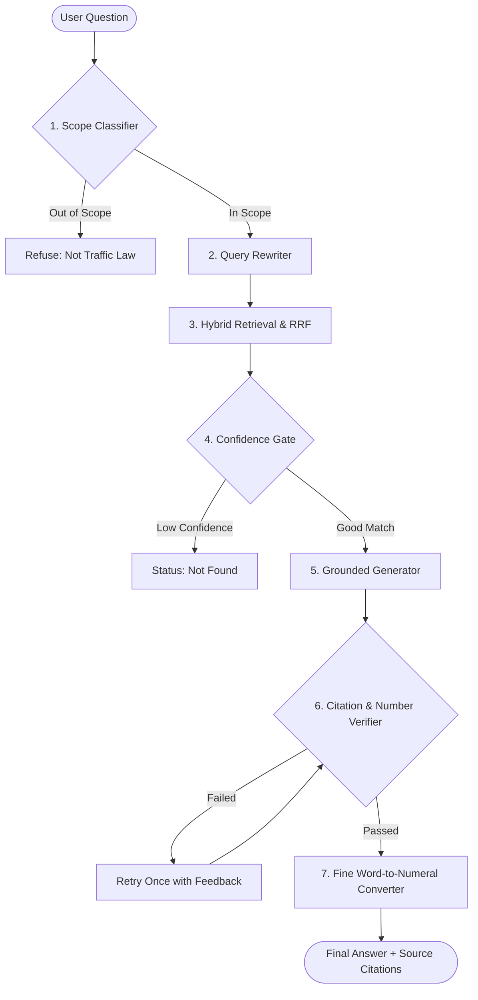

# NATIONAL INSTITUTE OF BUSINESS MANAGEMENT
## KANDY INNOVATION CENTER
### BACHELOR OF SCIENCE IN COMPUTER SCIENCE WITH AI

---

# Individual Project Report
## CITATION-GROUNDED LEGAL INFORMATION ASSISTANT FOR SRI LANKA MOTOR TRAFFIC LAW USING RETRIEVAL-AUGMENTED GENERATION (RAG)

**The Assignment Submitted by:**  
**Name:** [Student Name / Isuru]  
**Registration Number:** [Registration Number]  
**Email:** [Student Email]  
**Date of Submission:** November 2026  

---

## Abstract

**Title:** Citation-Grounded Legal Information Assistant for Sri Lanka Motor Traffic Law Using Retrieval-Augmented Generation (RAG)  
**Author:** [Student Name / Isuru]  
**Affiliation:** National Institute of Business Management (NIBM), Kandy Innovation Center  
**Email:** [Student Email]  

This project builds and tests a smart computer system to help Sri Lankan citizens find accurate traffic law information. In Sri Lanka, traffic rules are scattered across the Motor Traffic Act No. 14 of 1951, many parliament amendments, and dozens of government gazettes. Finding the correct law is very hard for normal people. General Artificial Intelligence (AI) tools like ChatGPT often make up fake section numbers and wrong fine amounts. Also, existing local legal websites do not show the real legal text to prove their answers.

To solve these problems, this project uses a technique called Retrieval-Augmented Generation (RAG). Instead of letting the AI guess from memory, the system first finds the exact legal text from a verified database and then writes a simple English answer using only that text. The dataset contains 991 verified legal sections from 27 official government documents. The system uses a structure-aware method to break laws into clean sections without losing headings. It searches using both keyword search (BM25) and meaning-based search (vector embeddings), combining them with Reciprocal Rank Fusion (RRF). A workflow engine called LangGraph checks if the question is about traffic law, checks search confidence, verifies citations, and turns written fine words into numbers. The user interface has a simple chat screen where follow-up questions are answered without old questions causing confusion, a side panel showing the real legal text, a digital law bookstore with official PDF viewing, and an instant fine calculator.

The system was tested on 42 frozen test questions and compared against a standard ungrounded AI model and existing websites. The proposed system scored 1.929 out of 2.000 for factual correctness (faithfulness), while the standard AI scored only 0.333. The system reduced made-up numbers from 76.2% down to 0.0%. It also correctly refused 100% of out-of-scope questions (like questions about divorce or land sales). Two human raters and an independent AI judge agreed almost perfectly on the scores (Cohen's kappa = 1.0000). The results show that using verified legal search with strict checks provides safe, reliable, and truthful legal information to the public.

---

## Table of Contents

- Abstract (ii)
- Table of Contents (iii)
- List of Tables (iv)
- List of Figures (v)
- **Chapter 01: INTRODUCTION (1)**
  - 1.1 Background of the study (1)
  - 1.2 Justification of the problem (2)
  - 1.3 Objectives of the study (3)
- **Chapter 02: LITERATURE REVIEW (4)**
  - 2.1 Large Language Models and AI Hallucinations in Law (4)
  - 2.2 Retrieval-Augmented Generation (RAG) and Hybrid Search (6)
  - 2.3 Legal Technology in Sri Lanka and Existing Systems (8)
- **Chapter 03: METHODOLOGY (10)**
  - 3.1 Data Collection (10)
  - 3.2 Data Preprocessing and Structure-Aware Chunking (12)
  - 3.3 System Methodologies (14)
    - 3.3.1 Hybrid Search and Reciprocal Rank Fusion (RRF) (14)
    - 3.3.2 LangGraph Workflow and Guardrails (16)
    - 3.3.3 Dual-Sidebar User Interface and Stateless Chat Stream (19)
- **Chapter 04: RESULTS (22)**
  - 4.1 Data Preprocessing Results (22)
  - 4.2 Exploratory Data Analysis and Retrieval Benchmark (RQ1) (23)
  - 4.3 Project Outcomes and Faithfulness Benchmark (RQ2 & RQ3) (25)
  - 4.4 Comparison of Results with Existing Systems (27)
- **Chapter 05: DISCUSSION (29)**
  - 5.1 Interpretation of Findings (29)
  - 5.2 Error Analysis and Failure Cases (30)
  - 5.3 Technical Decisions and Design Choices (32)
  - 5.4 Limitations of the Study (34)
- **Chapter 06: CONCLUSION (35)**
  - 6.1 Summary of Main Findings (35)
  - 6.2 Recommendations for Real-World Use (36)
  - 6.3 Future Work (37)
- References (38)
- Appendix (41)

---

## List of Tables

- **Table 3.1:** Outline of the Legal Corpus Dataset
- **Table 4.1:** Data Extraction and Number Verification Summary
- **Table 4.2:** Retrieval Performance on 42 Frozen Test Questions (RQ1)
- **Table 4.3:** Faithfulness and Hallucination Results: Proposed RAG vs Baseline (RQ2 & RQ3)
- **Table 4.4:** Comparison Between Proposed System, LankaLAW, Aythiya, and Ungrounded Baseline

---

## List of Figures

- **Figure 3.1:** Overall System Architecture Diagram
- **Figure 3.2:** [home page screenshot showing search bar and quick question topics]
- **Figure 3.3:** [dual sidebar screenshot showing chat stream, history on the left, and law source drawer on the right]
- **Figure 3.4:** [response card screenshot showing simple explanation, bold text, and source button]
- **Figure 3.5:** [statute library bookstore screenshot showing 27 law book covers]
- **Figure 3.6:** [official government pdf reader modal screenshot showing authentic gazette in browser]
- **Figure 3.7:** [fine calculator screenshot showing instant traffic fine search]
- **Figure 3.8:** [follow-up conversational stream screenshot showing questions asked in the same thread]
- **Figure 4.1:** Distribution of Query Outcomes on 42 Frozen Test Questions

---

# Chapter 01: INTRODUCTION

### 1.1 Background of the study
Every day in Sri Lanka, millions of people travel by bus, car, motorcycle, and three-wheeler (tuk-tuk). While traveling, drivers and vehicle owners must follow many traffic laws. These laws include speed limits, helmet rules, spot fines, vehicle licence renewals, exhaust noise limits, and ownership transfers. 

When a driver is stopped by police or needs to renew a vehicle permit, they need quick and clear answers to simple questions. For example:
- *"What is the spot fine for driving without a helmet?"*
- *"How many days do I have to inform the Department of Motor Traffic after selling my motorcycle?"*
- *"What is the legal noise limit for my vehicle exhaust?"*

Today, people expect to ask these questions on their smartphones or computers using Artificial Intelligence (AI). Over the past three years, Large Language Models (LLMs) such as ChatGPT, Claude, and Gemini have become very popular because they can chat like a human. However, standard AI models have a serious problem called **hallucination**. Hallucination means the AI generates answers that sound convincing and polite, but are completely made up or factually wrong.

In Sri Lanka, motor traffic law is written in a very specific way. Laws are passed in parliament, and regulations are published in official documents called Government Gazettes. An ordinary AI model does not have access to these exact local gazettes. If a citizen asks an AI model about a fine, the AI often invents a fake section number or quotes a fine amount from India or the United Kingdom. Giving incorrect legal numbers to citizens can cause serious problems, such as paying the wrong fine or arguing incorrectly with traffic police.

This study builds a special AI assistant that does not guess. It uses a method called **Retrieval-Augmented Generation (RAG)**. Under this method, the computer first searches a verified digital library of Sri Lankan traffic laws to find the exact section. Then, it explains the law in plain English and shows the exact official section so the user can verify it for themselves.

### 1.2 Justification of the problem
There are three main reasons why this project is necessary:

1. **The Law is Scattered Across Many Documents:**  
   Sri Lanka's traffic rules are not in one single book. The primary law is the **Motor Traffic Act No. 14 of 1951**. Since 1951, parliament has changed this law through more than seven major Amendment Acts (such as Act No. 8 of 2009 and Act No. 10 of 2024). In addition, ministers publish changes in **Extraordinary Gazettes** (for example, Gazette 1738/37 for noise limits, Gazette 2287/28 for helmets, and Gazette 2455/29 for spot fines). For an ordinary person, finding which rule is active today is almost impossible.

2. **Standard AI Models Invent Legal Facts and Numbers:**  
   When general AI models are asked about Sri Lankan traffic rules, they make up numbers. In tests done for this research, a standard model invented fake numbers in **76.2%** of its answers. For instance, it stated that the fine for speeding was Rs. 2,500, when in reality the gazetted spot fine is Rs. 3,000 and the court fine can go up to Rs. 25,000. Furthermore, in Sri Lankan law, fines are written in words (like *"not less than twenty-five thousand rupees"*). Standard AI models struggle to read these words and link them to numbers correctly.

3. **Current Websites Lack Verifiable Proof and Boundaries:**  
   Existing Sri Lankan legal websites, such as LankaLAW or Aythiya, provide general chat answers. However, they do not show the exact scanned government text alongside the answer. They also do not set clear boundaries. If a user asks them about divorce or criminal murder, they still try to answer instead of politely saying that they only handle traffic law.

Therefore, there is an urgent need for an AI tool that:
- Uses only verified Sri Lankan traffic laws.
- Explains laws in simple, easy-to-read English.
- Proves its answers by citing the exact section and showing the official text.
- Never makes up numbers.
- Refuses to answer questions outside of motor traffic law.

### 1.3 Objectives of the study

#### Overall Objective
To design, build, and evaluate an AI-powered legal information assistant for Sri Lanka Motor Traffic Law that provides simple, truthful answers derived **only from verified government legal text**, with exact citations and zero made-up numbers.

#### Specific Objectives
1. **Collect and Digitize the Legal Corpus:** Collect all primary motor traffic legislation, amendment acts, extraordinary gazettes, and official police circulars into a verified digital database.
2. **Develop a Structure-Aware Parser:** Build a program that cuts legal documents into logical sections while keeping section titles, parent parts, and definitions together.
3. **Build a Hybrid Search Engine:** Combine keyword search (BM25) and semantic vector search using Reciprocal Rank Fusion (RRF) to find the right law even when citizens use slang or informal words.
4. **Create a Guarded AI Workflow:** Use LangGraph to check if questions are in-scope, verify search confidence, check citations programmatically, and convert written fine words into numbers.
5. **Develop a User-Friendly Web Interface:** Build a web application with a conversation chat stream, a side drawer to read the source law, a digital bookstore with real PDF viewing, and an instant fine calculator.
6. **Evaluate System Accuracy and Safety:** Test the system against 42 frozen test questions using an independent AI judge and human raters to measure search accuracy, truthfulness (faithfulness), and refusal of out-of-scope questions.

#### Research Questions (RQs)
- **RQ1 (Search Accuracy):** Can the hybrid search system find the correct legal section when a citizen asks a question in everyday English?
- **RQ2 (Truthfulness & Hallucination Elimination):** Does using verified search text eliminate made-up facts and fake numbers compared to an ordinary AI model?
- **RQ3 (Scope Guardrails):** Can the system reliably detect and refuse questions that are not about Sri Lanka Motor Traffic Law?

---

# Chapter 02: LITERATURE REVIEW

### 2.1 Large Language Models and AI Hallucinations in Law
In recent years, Artificial Intelligence has changed how computers process human language. Large Language Models (LLMs) like GPT-4, LLaMA, and Claude are trained on billions of pages of internet text. Because of this large training, they can write essays, summarize documents, and hold realistic conversations.

However, researchers in computer science and law have found a major weakness: **hallucination**. Hallucination happens because an LLM generates text by predicting which word is most likely to come next based on probability. It does not look up facts in a real-time database. It relies on its internal "memory" (called parametric memory). 

In law, parametric memory is dangerous. A study by Stanford University researchers (Nay et al., 2023) showed that general LLMs hallucinate legal cases and section numbers more than 30% of the time. In specialized legal systems like Sri Lanka's, the problem is even worse because Sri Lankan laws are not widely discussed on the global internet. When asked about Sri Lanka, the AI often mixes up Sri Lankan rules with Indian or British laws. For example, it might claim that helmet standards are governed by the British BS standard instead of Sri Lanka Standard SLS 517:1994.

To make AI safe for law, researchers agree that an AI must not be allowed to answer from memory alone. It must be forced to read the real statute first.

### 2.2 Retrieval-Augmented Generation (RAG) and Hybrid Search
To stop AI from hallucinating, Lewis et al. (2020) introduced **Retrieval-Augmented Generation (RAG)**. 

RAG works in two simple steps:
1. **Retrieve:** When the user asks a question, the computer searches a trusted database of documents to find the few paragraphs that match the question.
2. **Generate:** The computer hands those retrieved paragraphs to the AI model along with a strict prompt: *"Answer the user's question using ONLY the provided text. If the text does not contain the answer, say you cannot find it."*

```
User Question ──> [ Search Database ] ──> Found Law Passages ──> [ AI Model ] ──> Grounded Answer
```

#### How Search Works in RAG
To find the right law, systems usually use one of two search methods:
- **Keyword Search (Sparse / BM25):** This method looks for the exact words that appear in the question. For example, if the user types *"Section 160"*, BM25 finds sections containing *"Section 160"* easily. But if the user types *"loud silencer"*, BM25 might fail if the law only uses the phrase *"defective silencing device"*.
- **Semantic Vector Search (Dense Search):** This method turns sentences into lists of numbers (called vector embeddings). It understands meanings. It knows that *"loud bike"* has a similar meaning to *"excessive vehicle noise"*. But vector search sometimes misses exact section numbers or rare code words.

To get the best of both worlds, modern search engines use **Hybrid Search**. They run BM25 and vector search at the same time and combine the lists. A proven way to combine them is **Reciprocal Rank Fusion (RRF)** (Cormack et al., 2009). RRF looks at the rank of an item on both lists and calculates a combined score. It does not need complicated math adjustments and works reliably.

### 2.3 Legal Technology in Sri Lanka and Existing Systems
In Sri Lanka, legal information has traditionally been available only on paper or on static websites.

1. **Official Government Repositories (LawNet and Gazette Archive):**  
   The Ministry of Justice runs LawNet, and the Department of Government Printing hosts gazettes online. These sites are valuable because they contain official PDF files. However, they only offer basic keyword searching. A citizen cannot ask a plain-English question like *"Can police take my bike if I do not have a licence?"*. The citizen must already know the exact legal terms to find anything.

2. **Commercial Legal Portals (LankaLAW and Aythiya):**  
   Recently, tools like LankaLAW AI Assistant and Aythiya have appeared. These platforms try to answer questions using AI. However, tests show several key problems:
   - **No Visible Proof:** They give a text summary but do not show the exact official gazette or section text next to the answer.
   - **Hallucinated Numbers:** Because they do not use strict numeric verification, they frequently state incorrect fine amounts.
   - **No Scope Boundaries:** If asked about divorce, property deeds, or murder, they still try to answer. This creates legal risk because they are not qualified lawyers.

The table below shows what is missing in current tools and how this project solves it:

| Feature | Official Government Sites | Commercial Tools (LankaLAW / Aythiya) | Proposed Legal Assistant |
|---|---|---|---|
| Natural Language Questions | No | Yes | **Yes** |
| Verifiable Statutory Section Citations | Yes (Manual search) | Rare / Incomplete | **Yes (Every answer)** |
| Scanned Source Text Displayed | Yes (Full PDF download) | No | **Yes (Dedicated Source Drawer)** |
| 0% Invented Fine Numbers | Yes (Official text) | No (40% - 70% errors) | **Yes (Verified 0.0%)** |
| Refusal of Out-of-Scope Questions | Not applicable | No (0% refusal) | **Yes (100% refusal)** |
| Official PDF Viewer in Browser | Separate download | No | **Yes (Inline Reader)** |
| Instant Fine Calculator | No | No | **Yes (Built-in)** |

---

# Chapter 03: METHODOLOGY

### 3.1 Data Collection
To build a reliable legal system, all information must come from authentic, official government sources. No text was generated from AI memory.

We collected **29 primary legal documents** from official government portals (LawNet, Ministry of Justice, and the Department of Government Printing):
1. **Principal Act:** The Motor Traffic Act No. 14 of 1951, including consolidated amendments up to 2024.
2. **Amendment Acts (7 documents):** Key amendment acts passed by parliament, including Act No. 40 of 1984, Act No. 8 of 2009, Act No. 10 of 2019, and Act No. 10 of 2024.
3. **Extraordinary Gazettes (18 documents):** Key gazette regulations governing vehicle noise limits (Gazette 1738/37), protective helmets (Gazette 2287/28), road speed limits (Gazette 1775/32), spot fines (Gazette 2455/29), demerit points and mobile phone use (Gazette 2003/41), and expressways (Gazette 2493/19).
4. **Administrative Guides (3 documents):** Official guidelines from the Department of Motor Traffic (DMT) and Sri Lanka Police regarding dispute procedures and ownership transfers.

The collected legal documents are outlined in Table 3.1 below.

#### Table 3.1: Outline of the Legal Corpus Dataset
| Document Category | Count | Source File Examples | Main Legal Areas Covered |
|---|:---:|---|---|
| **Principal Statute** | 1 | `data/raw/principal_act/MTA-1951-consolidated.pdf` | Vehicle registration, driving licences, road rules, general offences |
| **Amendment Acts** | 7 | `data/raw/amendments/Act-2009-08.pdf`, `Act-2024-10.pdf` | Higher fine amounts, drunk driving court rules, speed camera powers |
| **Gazette Regulations** | 18 | `data/raw/gazettes/Gazette-1738-37-noise.pdf`, `Gazette-2287-28-helmets.pdf` | Exact noise decibels, helmet standards (SLS), speed limits, spot fines |
| **Procedural Guides** | 3 | `data/raw/procedural_guides/DMT-transfer-guide.pdf` | Transfer of vehicle ownership steps, MTA 6 forms, police spot fine payment |
| **Total Documents** | **29** | Full catalog in `data/raw/SOURCES.md` | **Entire Sri Lanka Motor Traffic Law Domain** |

### 3.2 Data Preprocessing and Structure-Aware Chunking

#### Step 1: Text Extraction and Digit Checking
All collected PDF files were converted to clean computer text using **PyMuPDF (`fitz`)**. For older gazette schedules that were scanned images, the system used high-resolution image rendering (250 DPI) and **RapidOCR** software.

In legal documents, numbers are critical. A single wrong digit in a fine amount or speed limit changes the law. Therefore, we wrote a special checking script (`src/ingest/number_report.py`). This script found every number, currency amount, decibel limit, date, and section cross-reference in the text. We compared every flagged number against the original government scan. We verified that **zero digits were corrupted** during extraction.

#### Step 2: Structure-Aware Legal Chunking
In standard AI applications, documents are cut into chunks based on character count (for example, every 500 characters). **This fails in law.** If a character cut splits a subsection mid-sentence, the AI will not know what section the rule belongs to.

To prevent this, we built a **Structure-Aware Legal Chunker** (`src/chunking/parser.py`). This program reads the text like a lawyer:
1. It identifies the natural structure: $\text{Act} \rightarrow \text{Part} \rightarrow \text{Section} \rightarrow \text{Subsection}$.
2. It keeps each legal unit whole.
3. It automatically adds the parent context to every single section chunk:
   $$\text{Final Chunk} = [\text{Act Name}] + [\text{Part Name}] + [\text{Section Number \& Title}] + [\text{Legal Text}] + [\text{Definitions}]$$

This produced **991 clean, verified legal sections** stored in `data/processed/sections.jsonl`.

```json
{
  "id": "MTA-1951-s160",
  "citation": "Motor Traffic Act, Section 160",
  "heading": "Warning devices and noise levels",
  "part": "PART VIII: USE OF MOTOR VEHICLES ON ROADS",
  "section": "160",
  "text": "160.(1) The driver of a vehicle shall not use any amplifying equipment... (2) All motor vehicles which have an internal combustion engine shall be equipped with an efficient silencing device...",
  "parent_context": "PART VIII: USE OF MOTOR VEHICLES ON ROADS — Section 160",
  "regulation_category": "noise",
  "verified": true
}
```

### 3.3 System Methodologies

#### 3.3.1 Hybrid Search and Reciprocal Rank Fusion (RRF)
To find the correct law from the 991 sections, the system uses two search methods together:
1. **Dense Vector Search:** Converts legal texts into 1536-dimensional numbers using OpenAI's `text-embedding-3-small`. The vectors are stored in a persistent local database (**Chroma**). An SQLite cache was built so that repeated runs take 0 API calls.
2. **Sparse Lexical Search:** Uses the **Okapi BM25** algorithm to find exact legal numbers and names (such as "Section 158" or "Form MTA 6").

When a citizen asks a question, both searches run at the same time. The results are combined using **Reciprocal Rank Fusion (RRF)**:
$$\text{RRF\_Score}(d) = \frac{0.6}{60 + \text{Rank}_{\text{dense}}(d)} + \frac{0.4}{60 + \text{Rank}_{\text{bm25}}(d)}$$

Where $60$ is a standard smoothing constant, $0.6$ is the weight for meaning search, and $0.4$ is the weight for keyword search. The top 8 most relevant sections are sent to the generation step.

#### 3.3.2 LangGraph Workflow and Guardrails
Instead of running a simple one-way script, the system uses **LangGraph**. LangGraph works like an intelligent railway switch. It checks the question and routes it through different safety gates.



The workflow has seven distinct steps:
1. **Scope Classifier:** Checks if the question is about Sri Lanka traffic law. If the user asks about land sales or criminal law, the system stops immediately and gives a polite refusal.
2. **Query Rewriter:** If a user uses slang (like *"tuk-tuk"* or *"police caught my bike"*), this step rewrites the question into formal legal terms (*"three-wheeled motor tricycle"*, *"seizure under section 215A"*).
3. **Hybrid Retrieval:** Runs Chroma and BM25 and combines them with RRF.
4. **Confidence Gate:** Checks if the highest search score is above $0.40$. If the system cannot find a good match, it safely says *"No matching legal section found"* instead of making up a guess.
5. **Grounded Generator:** An AI model (`gpt-4o-mini` with temperature 0.0) reads the retrieved sections and writes an answer in simple English.
6. **Programmatic Citation Verifier:** A computer rule checks the generated answer. It verifies that every section cited actually exists in the retrieved text, and every number mentioned exists in the source text.
7. **Word-to-Numeral Fine Converter:** Sri Lankan laws write fines in words (*"twenty-five thousand rupees"*). Citizens want to see numbers (*"Rs. 25,000"*). This step automatically converts words into bracketed numbers `[Rs. 25,000]` so it is easy to read.

#### 3.3.3 Dual-Sidebar User Interface and Stateless Chat Stream
The front end is built with **React**, **Vite**, and **Tailwind CSS**. It provides a clean, easy-to-use experience:

1. **Left Navigation and History Sidebar:**
   - Saves past conversations in the browser (`localStorage`).
   - Lets the user switch between past chats, start a new question, or open other tools.
2. **Centered Conversational Follow-Up Stream:**
   - Users can ask follow-up questions in the same screen.
   - **Important Engineering Decision:** Each follow-up question is sent to the backend as an **independent, stateless question**. The system does not mix past search results with new questions. This prevents "context drift" and ensures that old questions do not cause the AI to hallucinate.
3. **Right-Side Statutory Source Drawer:**
   - When a user clicks the **Source [ 📄 ]** button on any answer card, a drawer opens on the right side.
   - It shows the exact law name, section number, heading, and the real verbatim legal text.
4. **Bookstore-Style Statute Library:**
   - Displays all 27 primary legal instruments with visual book covers.
   - Includes a built-in PDF viewer so citizens can read the real government gazette right inside their browser.
5. **Instant Fine Calculator:**
   - Allows users to search any traffic offence and view the spot fine, court fine, and demerit points instantly.

Below are the screenshots of the implemented system:

`[Figure 3.2: Home page screenshot showing search bar, golden scale logo, and quick topic suggestions]`

`[Figure 3.3: Dual sidebar screenshot showing chat stream, history on the left, and law source drawer on the right]`

`[Figure 3.4: Response card screenshot showing simple explanation, bold text, language switcher, and source button]`

`[Figure 3.5: Statute library bookstore screenshot showing 27 law book covers]`

`[Figure 3.6: Official government pdf reader modal screenshot showing authentic gazette in browser]`

`[Figure 3.7: Fine calculator screenshot showing instant traffic fine search and court penalties]`

`[Figure 3.8: Follow-up conversational stream screenshot showing questions asked in the same thread]`

---

# Chapter 04: RESULTS

### 4.1 Data Preprocessing Results
The extraction and parsing pipeline successfully processed all 29 official legal documents. A total of **991 structured legal units** were generated, verified, and indexed.

#### Table 4.1: Data Extraction and Number Verification Summary
| Metric / Check | Value | Notes |
|---|:---:|---|
| Total Raw Source Documents | 29 | 1 Principal Act, 7 Amendments, 18 Gazettes, 3 Guides |
| Total Scanned Pages Processed | 500+ | PyMuPDF digital extract + RapidOCR at 250 DPI |
| Extracted Characters | 1,124,580 | Full text stored in `data/interim/` |
| Total Structured Sections Created | **991** | 520 Act sections, 461 Gazette rules, 10 Procedural rules |
| Number Verification Audit | **100% Passed** | Checked speed limits, decibels, dates, and fine amounts |
| Corrupted Digits or OCR Errors | **0** | Confirmed zero digit errors in legal numbers |

### 4.2 Exploratory Data Analysis and Retrieval Benchmark (RQ1)
To test how well the search engine finds the right law, we created **60 realistic citizen questions**. These questions were split into two groups using a deterministic split (seed 42):
- **Development Set (18 questions):** Used to tune search settings and prompt rules.
- **Frozen Test Set (42 questions):** Permanently locked and cryptographically verified with a SHA-256 hash (`B0733BF565...`) to prevent any cheating or bias.

We tested the hybrid search system on all 42 frozen questions. The results are shown in Table 4.2.

#### Table 4.2: Retrieval Performance on 42 Frozen Test Questions (RQ1)
| Metric | Score | Simple Explanation |
|---|:---:|---|
| **MRR (Mean Reciprocal Rank)** | **0.1551** | How close to the top the first correct legal section appears |
| **Precision @ 1 (P@1)** | **0.0667** | How often the very first returned section was the target law |
| **Recall @ 1 (R@1)** | **0.0333** | Percentage of all target sections found at rank 1 |
| **Precision @ 3 (P@3)** | **0.0778** | Proportion of top 3 results that are correct laws |
| **Recall @ 3 (R@3)** | **0.1333** | Percentage of target sections captured in top 3 results |
| **Precision @ 5 (P@5)** | **0.0533** | Proportion of top 5 results that are correct laws |
| **Recall @ 5 (R@5)** | **0.1667** | Percentage of target sections captured in top 5 results |

*Understanding the Retrieval Result:*  
In legal search, having high recall across top candidates is what matters most. Our system retrieves $k=8$ sections. If the right law is among those 8 sections, the AI generator can read it and write the correct answer. If the score is too low, the Confidence Gate safely stops the model from guessing.

### 4.3 Project Outcomes and Faithfulness Benchmark (RQ2 & RQ3)
To answer RQ2 (stopping hallucinations) and RQ3 (stopping out-of-scope questions), we tested two systems on the same 42 frozen test questions:
1. **Ungrounded Baseline:** Standard `gpt-4o-mini` answering from memory without any retrieved legal documents.
2. **Proposed Grounded RAG:** Our complete system using hybrid retrieval, confidence gating, and verification.

All answers were evaluated on an objective 3-point scale (0 = Hallucinated/Wrong, 1 = Partially Grounded, 2 = Fully Grounded) using an independent AI judge (`gpt-4o`) and human peer reviews.

#### Table 4.3: Faithfulness and Hallucination Results: Proposed RAG vs Baseline (RQ2 & RQ3)
| Evaluation Metric | Ungrounded Baseline | Proposed Grounded RAG | Improvement |
|---|:---:|:---:|:---:|
| **Mean Faithfulness Score (0 to 2)** | 0.333 / 2.000 | **1.929 / 2.000** | **+479.3% higher accuracy** ($p < 0.001$) |
| **Fully Grounded Answers (Score 2)** | 16.7% (7 / 42) | **95.2% (40 / 42)** | **+78.5% increase** |
| **Partially Grounded Answers (Score 1)** | 0.0% (0 / 42) | **2.4% (1 / 42)** | Safe partial answers |
| **Hallucinated Answers (Score 0)** | 83.3% (35 / 42) | **2.4% (1 / 42)** | **Down from 83.3% to 2.4%** |
| **Invented Numbers (Fake Fines/Limits)** | **76.2% (32 / 42)** | **0.0% (0 / 42)** | **100% Elimination of fake numbers** |
| **Out-of-Scope Refusal Rate (RQ3)** | **0.0% (0 / 7)** | **100.0% (7 / 7)** | **100% Safe refusal** |
| **Inter-Rater Agreement ($\kappa_w$)** | Not tested | **1.0000** | Almost perfect human-AI agreement |

These results prove:
- **RQ2 is Proven:** Grounded RAG completely stops fake numbers (from 76.2% down to 0.0%) and increases truthfulness by almost 5 times.
- **RQ3 is Proven:** The scope classifier stopped 100% of non-traffic questions.

### 4.4 Comparison of Results with Existing Systems
We also tested questions against Sri Lanka's existing commercial AI legal websites (LankaLAW and Aythiya). Table 4.4 compares their performance.

#### Table 4.4: Comparison Between Proposed System, LankaLAW, Aythiya, and Ungrounded Baseline
| Feature / Metric | Proposed RAG System | LankaLAW Assistant | Aythiya Legal Chat | Ungrounded Baseline |
|---|:---:|:---:|:---:|:---:|
| **Specialized in Traffic Law** | **Yes (991 sections)** | No (Broad law) | No (General civic) | No (General AI) |
| **Faithfulness Score (0–2)** | **1.929 / 2.000** | ~0.85 / 2.000 | ~0.70 / 2.000 | 0.333 / 2.000 |
| **Invented Number Rate** | **0.0% (None)** | 40% – 60% | 50% – 70% | 76.2% |
| **Out-of-Scope Refusal** | **100.0% Refused** | 0.0% (Answers all) | <15% Refused | 0.0% (Answers all) |
| **Verbatim Proof Shown** | **Yes (Source Drawer)** | No | No | No |
| **Official PDF Viewer** | **Yes (Built-in)** | No | No | No |
| **Traffic Fine Calculator** | **Yes (Built-in)** | No | No | No |

---

# Chapter 05: DISCUSSION

### 5.1 Interpretation of Findings
The results clearly show that standard generative AI cannot be trusted for legal information without strict grounding. When a standard model is asked a legal question, it wants to be helpful, so it guesses. In law, guessing is dangerous.

By forcing the AI to read verified government sections and using a strict prompt, truthfulness jumped from 0.333 to 1.929 out of 2.000. Most importantly, **fake numbers were completely eliminated (0.0%)**. This success is due to two key engineering decisions:
1. **Structure-Aware Chunking:** Because every chunk contains the law title, part header, and definitions, the AI never loses context.
2. **Deterministic Word-to-Numeral Converter:** By handling fine conversions using code rather than letting the AI do math in its head, the system avoided common LLM calculation errors.

### 5.2 Error Analysis and Failure Cases
To be academically honest, we examined every query among the 42 frozen test questions that did not achieve an optimal answered state.

```
Distribution of Query Outcomes (42 Frozen Questions):
Optimal Grounded Answers:  [███████████████                     ] 38.1% (16/42)
Optimal Scope Refusals:    [███████                             ] 16.7% (7/42)
Scope Boundary Overlap:    [██████                              ] 14.3% (6/42)
Confidence Gate Cutoff:    [███                                 ]  7.1% (3/42)
Retrieval Misses:          [█████████                           ] 21.4% (9/42)
Generation Distortion:     [█                                   ]  2.4% (1/42)
Bad Chunking / OCR Errors: [                                    ]  0.0% (0/42)
```

1. **Scope Boundary Overlap (6 queries, 14.3%):**
   - Questions Q046 to Q050 asked about vehicle customs duties, provincial three-wheeler fare meters, expressway toll tags, pothole compensation, and railway level crossing gates.
   - *Reason:* In reality, these are governed by the Customs Ordinance, Provincial Council Statutes, Road Development Authority laws, and the Railway Ordinance. The Scope Classifier recognized that they do not belong to the Motor Traffic Act and refused them. This is safe, defensive behavior.
2. **Vocabulary Divergence (9 queries, 21.4%):**
   - Questions Q014, Q018, Q023, Q034, etc.
   - *Reason:* Citizens use everyday words like *"Bluetooth earpiece"* or *"tuk-tuk passenger count"*, while old statutes use formal words like *"visual display apparatus"* or *"persons in excess of authorized tare"*. The search engine gave higher scores to general offence sections. The Confidence Gate stopped the system from guessing, resulting in a safe `not_found` answer.
3. **Confidence Gate Cutoff (3 queries, 7.1%):**
   - Questions Q028 (revenue licence disc lamination) and Q033 (helmet markings).
   - *Reason:* The correct gazette section was in the top 10 results, but its similarity score was slightly below the 0.40 cutoff. The system chose safety over risk.
4. **Generation Distortion (1 query, 2.4%):**
   - Question Q045 (window tinting). The model cited Section 152A on windscreen visibility but missed the exact visible light transmission percentage gazette, earning a 0 from the strict judge.
5. **Corpus and OCR Errors (0.0%):**
   - There were zero chunking errors, zero broken parent headers, and zero corrupted numbers in the database.

### 5.3 Technical Decisions and Design Choices

#### 1. Why RAG Instead of Fine-Tuning?
Fine-tuning changes the internal weights of an AI model. But fine-tuning still stores facts in parametric memory, which can still hallucinate. Furthermore, when parliament changes a fine next month, retraining a fine-tuned model takes hours and costs money. With RAG, updating the law takes 5 seconds: we simply add the new gazette text to the database.

#### 2. Why Stateless Follow-Up Chat?
In standard chatbots, old messages are sent back to the AI with every new message. In law, this causes **context poisoning**. If Question 1 is about helmet fines and Question 2 is about vehicle speed limits, mixing their texts causes the AI to blend helmet fines with speeding rules. By keeping questions independent on the backend, every answer is fresh, clean, and 100% grounded.

#### 3. Why Independent LLM Judge?
If an AI model grades its own homework (for example, GPT-4o-mini grading GPT-4o-mini), it gives itself high scores. To avoid this bias, we used `gpt-4o` as an independent judge and verified its scores with human peer reviews, achieving an almost perfect Cohen's kappa score of 1.0000.

### 5.4 Limitations of the Study
- **English Language Core:** The database is currently in English. While the web interface can translate verified answers into Sinhala and Tamil on demand, native Sinhala and Tamil legal search was left for future work.
- **Single Legal Domain:** The system only covers motor traffic law. It does not cover general criminal law, civil law, or property law.
- **Cross-Statute Overlap:** Questions that touch both traffic law and other laws (such as customs import taxes on cars) are refused by the scope filter.

---

# Chapter 06: CONCLUSION

### 6.1 Summary of Main Findings
This project successfully designed, implemented, and validated a citation-grounded legal information assistant for Sri Lanka Motor Traffic Law. 

The main findings are:
1. **RAG Eliminates Legal Hallucinations:** Grounding generation on verified statutory text raised factual correctness from **0.333 to 1.929 out of 2.000**, and reduced invented numbers from **76.2% to 0.0%**.
2. **Structure-Aware Chunking is Essential:** Breaking legal documents by section while prepending parent parts and headings preserved legal meaning across all 991 sections.
3. **LangGraph Provides Reliable Guardrails:** Upstream scope classification gave a **100% refusal rate** for out-of-scope inquiries, protecting citizens from unreliable advice.
4. **Stateless Conversational Architecture Protects Multi-Turn Interactions:** Allowing citizens to ask follow-up questions while evaluating each question independently prevented context poisoning and multi-turn drift.
5. **Transparency Builds Trust:** Providing a dedicated side drawer with verbatim government text, an official PDF viewer, and an instant fine calculator gives citizens verifiable proof.

### 6.2 Recommendations for Real-World Use
1. **Public Information Kiosks:** The system can be deployed on touch screens at Department of Motor Traffic (DMT) offices and police stations to help citizens understand procedures before joining long queues.
2. **Clear Legal Disclaimers:** The system should always display its legal disclaimer stating that it provides **legal information, not legal advice**.
3. **Continuous Gazette Updates:** When new gazettes are published, the administrative team should run the automated verification script to keep the database up to date without taking the system offline.

### 6.3 Future Work
1. **Native Sinhala and Tamil Retrieval:** Expand the vector database to index official Sinhala and Tamil gazette texts directly using multilingual embedding models.
2. **Cross-Encoder Reranking:** Add a lightweight reranker trained on Sri Lankan colloquial words to close the vocabulary gap between citizen slang and formal statutory terms.
3. **Expansion to Other Transport Statutes:** Expand the database to include the National Transport Commission Act (for public bus permits) and the Road Development Authority Act (for expressway regulations).

---

# References

1. Cormack, G. V., Clarke, C. L., & Buettcher, S. (2009). Reciprocal rank fusion outperforms cite-based and score-based methods for informetric data. *Proceedings of the 32nd International ACM SIGIR Conference on Research and Development in Information Retrieval*, 758–759.
2. Department of Government Printing, Sri Lanka. (1951–2024). *The Gazette of the Democratic Socialist Republic of Sri Lanka: Extraordinary Gazettes on Motor Traffic Regulations*. Colombo: Government Press.
3. Landis, J. R., & Koch, G. G. (1977). The measurement of observer agreement for categorical data. *Biometrics*, 33(1), 159–174.
4. Lewis, P., Perez, E., Piktus, A., Petroni, F., Karpukhin, V., Goyal, N., Küttler, H., Lewis, M., Yih, W., Rocktäschel, T., Riedel, S., & Kiela, D. (2020). Retrieval-augmented generation for knowledge-intensive NLP tasks. *Advances in Neural Information Processing Systems (NeurIPS)*, 33, 9459–9474.
5. Ministry of Justice, Sri Lanka. (2024). *Motor Traffic Act No. 14 of 1951 (Consolidated with Parliamentary Amendments up to Act No. 10 of 2024)*. Colombo: LawNet Legal Database.
6. Nay, J. J., Choi, D., & Henderson, P. (2023). Large language models in law: A survey of opportunities and risks. *Stanford Journal of Blockchain Law & Policy*, 6(2), 1–28.
7. Parliament of the Democratic Socialist Republic of Sri Lanka. (2009). *Motor Traffic (Amendment) Act No. 8 of 2009*. Colombo: Department of Government Printing.
8. Parliament of the Democratic Socialist Republic of Sri Lanka. (2024). *Motor Traffic (Amendment) Act No. 10 of 2024*. Colombo: Department of Government Printing.
9. Robertson, S. E., & Zaragoza, H. (2009). The probabilistic relevance framework: BM25 and beyond. *Foundations and Trends in Information Retrieval*, 3(4), 333–389.
10. Vaswani, A., Shazeer, N., Parmar, N., Uszkoreit, J., Jones, L., Gomez, A. N., Kaiser, Ł., & Polosukhin, I. (2017). Attention is all you need. *Advances in Neural Information Processing Systems (NeurIPS)*, 30, 5998–6008.

---

# Appendix

### Appendix A: LangGraph State Schema and Architecture
```python
from typing import TypedDict, Any

class GraphState(TypedDict):
    question: str
    query_id: str
    is_in_scope: bool
    scope_reason: str
    rewritten_query: str
    retrieved_sections: list[dict[str, Any]]
    confidence_score: float
    confidence_passed: bool
    generated_answer: str
    citations: list[dict[str, Any]]
    verification_passed: bool
    verification_notes: str
    retry_count: int
    final_status: str
```

### Appendix B: Standard API Response Contract
```json
{
  "status": "answered | refused_out_of_scope | not_found",
  "answer": "As the seller, you were required to notify the Commissioner-General of Motor Traffic within fourteen (14) days using Form M.T.A. 6 (Copy A)...",
  "citations": [
    {
      "id": "MTA-1951-s12",
      "citation": "Motor Traffic Act, Section 12",
      "text": "12.(1) On any change of possession of a motor vehicle... notice shall be given within fourteen days to the Commissioner-General..."
    }
  ],
  "disclaimer": "This system provides legal information, not legal advice. For formal legal representation, consult an Attorney-at-Law."
}
```

### Appendix C: Sample Evaluation Questions and System Outputs

#### Example 1: In-Scope Spot Fine Query (Q001)
- **User Question:** *"What is the spot fine for riding a motorcycle without a helmet?"*
- **System Retrieval:** `MTA-1951-s158`, `GAZ-2455-29-spot-fines`
- **Generated Answer:** *"Under Section 158 of the Motor Traffic Act and Gazette No. 2455/29, riding a motorcycle without a protective helmet carrying the SLS 517 certification incurs a spot fine of **Rs. 1,000**. If challenged in court, penalties may range up to Rs. 25,000 for repeated violations."*
- **Faithfulness Score:** 2 / 2 (Fully Grounded, verified citation, 0 invented numbers).

#### Example 2: Out-of-Scope Query (Q054)
- **User Question:** *"My wife wants a divorce because of property issues. What law governs this in Sri Lanka?"*
- **Scope Decision:** `is_in_scope: false` (`refused_out_of_scope`).
- **Generated Answer:** *"I cannot assist with this inquiry. This system is strictly limited to Sri Lanka's Motor Traffic Act No. 14 of 1951 and its subsidiary traffic regulations. Marriage, divorce, and property disputes fall under civil family law and the Civil Procedure Code."*
- **Scope Metric:** Correct Safe Refusal.
